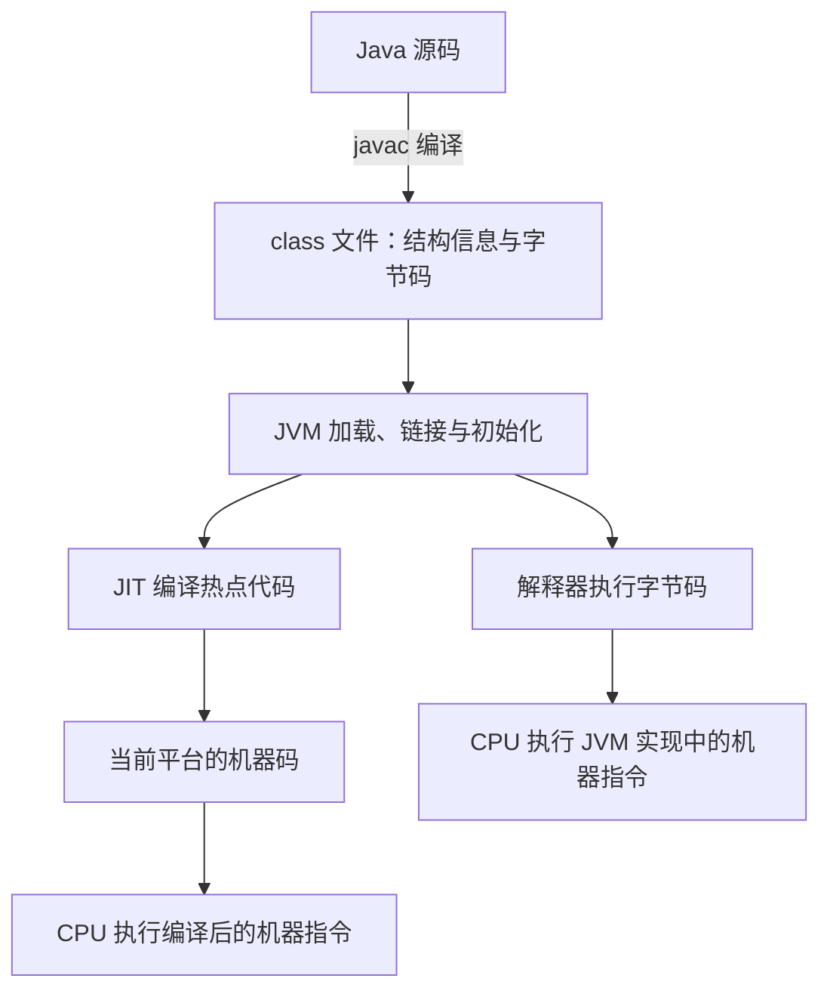

开发 Java 应用时，我们通常在 IDE 中点击运行，或者执行一条命令：

```sh
java -jar app.jar
```

随后，服务启动，接口开始接收请求。编译器、类库、依赖和运行环境似乎都退到了背景中。

但换一台机器，事情就可能不同：同一个 JAR 找不到类，换了 Java 版本后找不到方法，明明设置了 `JAVA_HOME`，程序却仍然由另一个 JDK 启动。要理解这些现象，需要重新看清工具替我们隐藏的过程。

上一篇关于面向对象的讨论，从现实问题走向类、接口和对象。这一篇继续往下走：**用 Java 表达的程序，如何经过编译、加载和执行，最终在目标机器上运行？**

本文以 Java 17 为背景，围绕常见的 classpath 应用展开；涉及解释器与 JIT 时，以 HotSpot 的常见执行方式为例。理解这条链路，也就能把 JDK、字节码、JAR 和版本兼容放回各自的位置。

## 从一段代码开始：源码如何变成正在执行的程序

先把 IDE 和构建工具暂时放到一边。保存下面的代码为 `src/demo/Main.java`：

```java
package demo;

public class Main {
    public static void main(String[] args) {
        System.out.println("Hello, Java");
    }
}
```

在项目目录中执行：

```sh
javac -d out src/demo/Main.java
java -cp out demo.Main
```

这两条命令分别承担不同工作。

`javac` 读取源码，按照语言规则检查类型、方法调用等内容，生成 `out/demo/Main.class`。这个文件包含类、字段、方法、常量池等结构信息，以及方法中的字节码指令。

`java` 是启动器。它启动 JVM，并指定入口类 `demo.Main`。JVM 加载这个类，完成相关链接和初始化，再调用它的 `main` 方法。程序执行中用到的其他类，也会按需加载和处理。

链接涉及验证、准备和解析。相关动作受规范约束，但不必把它们理解成启动时对所有类一次性完成的流水线；符号引用的解析可以延迟到实际使用时。启动成功，也就不代表所有执行路径需要的类和方法都已经检查完毕。

这里有一个关键分界：**`javac` 通常生成面向 JVM 的字节码，CPU 执行的是面向具体处理器的机器指令。** 字节码需要由 JVM 的实现负责执行。

在常见的 HotSpot 执行模式下，方法可以先由解释器执行。JVM 同时收集运行信息，对频繁执行的方法或代码区域进行即时编译，也就是 JIT，将其编译为当前平台的机器码。后续满足条件的执行可以使用这些机器码。



解释器本身也是运行在机器上的程序；它读取字节码并完成相应操作。JIT 则把选中的代码编译为机器码，减少后续执行中的解释开销，并利用运行时信息进行优化。编译需要时间和资源，因此不会把“每段代码都必须先经过 JIT”作为运行前提。

所以，讨论 Java 是编译型还是解释型语言，首先要明确讨论哪个阶段：源码会先编译为字节码，而字节码又可以被解释执行或即时编译。JVM 规范规定执行语义，具体执行策略由实现决定。

## 字节码这一层，为什么能带来跨平台能力

既然最终都要执行机器指令，为什么还要保留字节码这一层？

因为机器指令与目标平台有关。x86-64 和 ARM64 有不同的指令集，操作系统也有不同的系统调用与运行约定。直接面向这些差异生成程序，通常需要为目标平台分别构建。

Java 在中间建立了一套统一的虚拟机契约：class 文件使用什么格式，字节码指令表达什么含义，类如何加载和初始化，方法调用应呈现怎样的行为。这些规则由 JVM 规范定义。

只要程序遵守相应的平台契约，同一份字节码就可以交给不同平台上的兼容 JVM。Windows 上的 JVM 和 Linux 上的 JVM 分别处理底层差异；JIT 生成的机器码也属于各自的平台。

**应用携带可移植的字节码，目标机器提供适配本地平台的运行环境。** 这就是“一次编译，到处运行”的主要基础。

但运行环境能够屏蔽的差异有边界。如果应用加载本地动态库，那个库仍然需要匹配操作系统和 CPU 架构。文件路径、大小写规则、权限、字符编码以及外部服务配置，也可能随环境变化。

Java 17 中，依赖默认字符集处理文本尤其需要注意：开发机和服务器的默认值可能不同。数据格式已经约定 UTF-8 时，显式使用 UTF-8，才能让这个约定随程序一起迁移。

因此，判断应用是否能跨平台，需要同时检查字节码与 JVM 的兼容性，以及应用直接依赖的环境条件。跨平台能力建立在明确的契约上，应用越少依赖平台特有细节，就越容易迁移。

## 我们安装的 JDK，究竟提供了什么

执行过程清楚之后，JDK、JRE 和 JVM 就容易理解了。

JVM 负责执行字节码；运行一个普通 Java 程序，还需要 `String`、集合、文件操作等标准类库，以及其他运行支持，这些共同构成 JRE 所描述的运行环境。开发程序则还需要编译器、调试和诊断工具，JDK 提供这些工具及运行能力。

| 名称 | 主要职责 | 在前面例子中的位置 |
| --- | --- | --- |
| JVM | 按虚拟机规则执行程序 | 加载入口类、执行方法 |
| JRE | 提供 JVM、标准类库和运行支持 | 提供程序实际运行所需的平台能力 |
| JDK | 提供开发工具和运行能力 | 提供 `javac`、`java` 等工具 |

这是一组职责关系。现代 JDK 的磁盘布局不一定按“JDK 目录内有 JRE，JRE 目录内有 JVM”排列。Java 17 的 JDK 没有传统的 `jre/` 子目录，依然可以运行 Java 应用。

进一步看，JVM 规范和实际安装的软件也属于不同层次。HotSpot、Eclipse OpenJ9 是 JVM 的不同实现：它们遵守相应版本的规范，但可以采用不同的编译优化、垃圾回收和诊断机制。

OpenJDK 是开源项目，提供构建 JDK 所需的源代码，其中包括 HotSpot、标准类库和开发工具。Oracle JDK、Eclipse Temurin 则是基于 OpenJDK 构建和发布的 JDK 发行版，均使用 HotSpot。发行组织负责构建、测试、补丁和支持安排，因此选择发行版时，还要考虑平台覆盖、许可与维护政策。

这几个名称回答的分别是：平台遵循什么规则、虚拟机如何实现，以及我们安装的是谁提供的软件。

还有一个容易被忽略的问题：安装了哪个 JDK，和当前命令实际使用哪个 JDK，需要分别确认。

`JAVA_HOME` 是许多工具约定读取的 JDK 路径。直接在终端输入 `java` 或 `javac` 时，Shell 通常根据 `PATH` 查找命令，别名和版本管理工具也可能参与选择。IDE、Maven 及编译工具链还可以独立配置 JDK。

在 Linux 或 macOS 上，可以从这些信息开始定位：

```sh
command -v java
command -v javac
java -version
javac -version
mvn -version
```

排查时，需要沿着终端、构建工具和应用启动方式确认实际路径。一个环境变量的值，无法替代对实际执行环境的检查。

## 从一个类到一个应用：程序如何找到它需要的代码

前面的程序只写了一个业务类。现在把问候文本交给另一个类，保存为 `src/demo/message/Greeting.java`：

```java
package demo.message;

public class Greeting {
    public static String message() {
        return "Hello, Java";
    }
}
```

将 `Main.java` 改为：

```java
package demo;

import demo.message.Greeting;

public class Main {
    public static void main(String[] args) {
        System.out.println(Greeting.message());
    }
}
```

一起编译后，输出目录是：

```text
out/
└── demo/
    ├── Main.class
    └── message/
        └── Greeting.class
```

启动命令仍然是：

```sh
javac -d out src/demo/Main.java src/demo/message/Greeting.java
java -cp out demo.Main
```

`demo.message.Greeting` 是类的全限定名。按照传统 classpath 规则，查找器将它对应到 `demo/message/Greeting.class`，再从 classpath 中的目录或 JAR 查找。

因此，classpath 根目录应是 `out`。如果指定 `out/demo`，查找器还会继续拼接包路径，无法按预期找到这些类。

源码中的 `import` 让我们可以用短名称 `Greeting` 表达这个类型。它参与编译时的名称解析；运行时查找哪些目录和 JAR，由运行环境的加载配置决定。

### JAR 让代码便于交付，运行时仍然需要找到依赖

当类越来越多，可以将输出目录打成普通 JAR：

```sh
jar --create --file app.jar -C out .
java -cp app.jar demo.Main
```

JAR 保存了包路径和文件，可以作为传统 classpath 的一个条目。这条打包命令没有配置入口类，所以这里通过 `-cp` 和主类名启动。

如果以后引用第三方库，就需要把库提供给编译器，并在运行时提供给 JVM。假设依赖 JAR 放在 `lib` 目录，Linux 或 macOS 上的命令可以写成：

```sh
javac -cp 'lib/*' -d out src/demo/Main.java src/demo/message/Greeting.java
java -cp 'out:lib/*' demo.Main
```

Windows 的 classpath 分隔符使用 `;`。IDE 和 Maven 通常会自动组织这些路径，但编译和运行仍分别使用自己的依赖集合。

编译器需要依赖来检查类型和方法；运行时需要依赖来加载类、解析成员并执行代码。class 文件通常保留对外部类和方法的符号引用，编译成功不会把所有依赖的实现自动复制进去。

假如编译时有某个 SDK，而部署时没有携带它，程序就可能在相关类加载时失败。使用显式类加载 API 时可能看到 `ClassNotFoundException`；执行过程中无法获得需要的类定义时，可能看到 `NoClassDefFoundError`。后者也可能来自先前的类初始化失败，排查需要结合完整异常链。

Maven 的依赖范围会影响这些集合。例如，`compile` 依赖通常同时参与主代码编译和运行；`runtime` 依赖供运行时使用；`provided` 表示编译需要、预期由环境提供；`test` 用于测试。最终哪些依赖进入制品，还取决于打包插件及其配置，需要查看实际产物。

### Spring Boot 怎样把启动过程封装进一个 JAR

普通 Maven JAR 通常只打包本模块代码；Spring Boot 可执行 JAR 采用专门的布局和启动器，可以将业务代码与依赖一起交付。

以本项目采用的 Spring Boot 3.5 为例，结构简化如下：

```text
app.jar
├── META-INF/MANIFEST.MF
├── org/springframework/boot/loader/...
└── BOOT-INF/
    ├── classes/     业务类与资源
    └── lib/         第三方依赖 JAR
```

执行 `java -jar app.jar` 时，Java 启动器根据 manifest 找到入口。这里的入口是 Boot Launcher；它组织业务类和嵌套依赖的加载路径，再调用应用主类。`BOOT-INF` 的布局是 Spring Boot 的打包约定。

对于普通可执行 JAR，manifest 也可以指定主类和外部依赖路径。启动方式应与制品约定一致：`java -jar` 模式会忽略另外指定的普通 classpath 设置，不能指望在命令上随意补一个 `-cp` 就能解决依赖问题。

遇到“IDE 能运行，服务器不能运行”，值得检查最终 JAR 的内容、manifest 和实际启动命令。开发工具提供过的依赖，必须通过打包或部署配置进入生产运行环境。

## 换一个 Java 版本：哪些约定可能对不上

现在可以看懂一个常见问题：开发机使用 JDK 17，服务器使用 Java 11，应用应该怎样构建？

首先需要分清三个版本：编译器运行在哪个 JDK 上、希望面向哪个平台版本生成程序，以及应用最终在哪个 Java 运行环境中执行。

JDK 17 的 `javac` 默认生成面向 Java 17 的 class 文件，其主版本号是 61。Java 11 对应的主版本号是 55，无法加载这个较新的普通 class 文件，因此可能抛出 `UnsupportedClassVersionError`。出错的类也可能来自第三方依赖，只降低业务代码的目标版本未必足够。

但 class 版本匹配，只解决了运行环境是否认识文件格式的问题。

### 字节码版本正确，也可能调用了不存在的方法

下面的例子没有使用复杂语法，保存为独立文件 `ApiDemo.java`：

```java
import java.util.stream.Stream;

public class ApiDemo {
    public static void main(String[] args) {
        System.out.println(Stream.of("a", "b").toList());
    }
}
```

`Stream.toList()` 是 Java 16 引入的方法。在 JDK 17 上执行：

```sh
javac -source 11 -target 11 ApiDemo.java
```

语言规则和 class 目标版本都设成了 11，但编译器仍可能从当前 JDK 17 的平台类库看到 `toList()`，因此编译通过。生成的 class 可以被 Java 11 识别，执行到这个调用时，却会因方法不存在而抛出 `NoSuchMethodError`。

更合适的构建方式是：

```sh
javac --release 11 ApiDemo.java
```

`--release 11` 同时约束语言规则、class 文件版本和编译时可见的平台 API。编译器会直接拒绝这里的 `toList()` 调用，把问题提前暴露在构建阶段。

不过，`--release` 的约束针对正在编译的源码及目标平台 API。它不会改写新语法，不会转换已经编译好的第三方 JAR，也不会自动把测试 JVM 切换为 Java 11。通过反射访问的方法，也可能绕过普通编译期检查。

所以，高版本 JDK 构建低版本目标，既要设置编译约束，也要选择兼容的依赖，并在目标运行环境中验证实际执行路径。

### 旧程序升级到新 JDK，也需要分层判断

反过来，把 Java 11 程序放到 Java 17 上，通常更容易。Java 重视向后兼容，但能识别旧 class 文件，只是应用运行所需的一个条件。

旧程序可能使用已移除的平台组件，依赖不再允许的内部访问，或者受安全配置和默认行为变化影响。例如，从 JDK 8 跨到后续版本时，曾随 JDK 提供的 JAXB 等组件可能需要补充独立依赖；升级到 Java 17 时，某些依赖 JDK 内部成员反射访问的旧库可能需要更新。

讨论升级是否兼容，可以分别问：

| 兼容性 | 要回答的问题 |
| --- | --- |
| 源码兼容 | 原有源码不修改，在新编译环境和依赖下，能否重新编译通过？ |
| 二进制兼容 | 保留已编译的调用方，替换依赖后，原有类和成员引用能否继续链接？ |
| 行为兼容 | 相同业务条件下，返回值、异常和副作用等是否仍符合原有契约？ |

例如，类库保留 `format(String)`，再新增 `format(Integer)`，旧二进制仍然知道自己调用的是哪一个方法，可以继续链接；但源码中的 `format(null)` 重新编译时会因重载歧义失败。如果方法签名完全保留，却把“找不到数据时返回 `null`”改为抛异常，编译和链接也可能都成功，原有业务逻辑却发生变化。

这也是为什么升级需要同时检查构建、依赖与关键业务路径。仅仅启动成功，无法证明所有链接和行为都符合预期。

LTS 则回答维护时间的问题。它表示发行商或维护组织对某个版本提供较长期的更新安排；非 LTS 版本也是正式发布版本，维护窗口通常较短。支持期限、许可和服务范围需要结合发行版确认。选择 LTS 有助于减少频繁迁移的成本，持续安装补丁和验证升级仍然必要。

## 回到交付：运行一个 Java 应用，需要准备什么

现在回到开头的命令：

```sh
java -jar app.jar
```

这个文件能够运行，依赖一组已经协调好的条件：入口和打包方式一致，业务类与第三方依赖完整，运行环境支持相应的 class 版本与平台 API，配置和外部资源也满足应用要求。

开发阶段需要编译器，运行已经编译好的程序则通常不需要完整 JDK。可以使用完整 JDK、厂商提供的运行时发行包，或者满足应用需求的定制运行时。若应用要动态编译源码，或运维需要特定诊断工具，则还需要提供对应能力。

从 JDK 9 开始，平台类库按模块组织，运行时映像也随之调整。Java 17 不再使用旧的 `rt.jar` 和内嵌 `jre/` 布局。模块化让运行环境可以按需求组合，`jlink` 能根据模块依赖生成定制运行时。

不过，定制运行时需要包含应用实际用到的平台模块，反射、服务发现和动态加载路径也要考虑。生成的运行时包含本地 JVM 和支持文件，仍然面向特定操作系统与 CPU 架构；安全更新时也需要重新构建并交付。收益与维护成本应一起评估。

对日常后端开发，更有价值的是形成一条稳定的判断路径：从源码和编译约束，检查生成的制品；从制品和启动方式，检查依赖如何加载；再确认实际运行环境及业务行为。

Java 的这些机制各有职责，也相互衔接。字节码建立可移植的执行边界，JVM 在目标平台兑现执行语义，类库和依赖提供程序需要的能力，构建与部署则把它们组合成可交付的应用。理解这些关系，我们就能说明程序为什么能运行，也能在它运行失败时找到需要核查的条件。

## 参考资料

中文资料用于参考例子组织与概念覆盖；版本相关结论以本文的 Java 17 背景及官方说明为准。

- [廖雪峰：第一个 Java 程序](https://liaoxuefeng.com/books/java/quick-start/dev-env/first-program/index.html)：从源码、编译命令到启动过程。
- [廖雪峰：classpath 和 jar](https://liaoxuefeng.com/books/java/oop/basic/classpath-jar/index.html)：包路径、查找目录和普通 JAR。
- [廖雪峰：class 版本](https://liaoxuefeng.com/books/java/oop/basic/class-version/index.html)：class 版本、跨版本构建和平台 API 边界。
- [JavaGuide：Java 基础常见面试题总结（上）](https://javaguide.cn/java/basis/java-basic-questions-01.html)：JDK、字节码、解释执行和即时编译的概念覆盖。
- [二哥的 Java 进阶之路：一文让你彻底了解 Java](https://javabetter.cn/overview/what-is-java.html)：Java 背景与语言机制的叙述参考。
- [Java SE 17 虚拟机规范](https://docs.oracle.com/javase/specs/jvms/se17/html/index.html)：class 文件、加载、链接和初始化的规范依据。
- [Java 17 java 命令说明](https://docs.oracle.com/en/java/javase/17/docs/specs/man/java.html)与 [javac 命令说明](https://docs.oracle.com/en/java/javase/17/docs/specs/man/javac.html)：启动方式、classpath 和编译参数。
- [JEP 247：Compile for Older Platform Versions](https://openjdk.org/jeps/247)：`--release` 的设计目的与平台 API 约束。
- [Java SE 17 语言规范：二进制兼容性](https://docs.oracle.com/javase/specs/jls/se17/html/jls-13.html)：类与接口演进对既有二进制的影响。
- [Maven：依赖机制](https://maven.apache.org/guides/introduction/introduction-to-dependency-mechanism.html)：依赖范围与传递依赖。
- [Spring Boot 3.5：可执行 JAR 的嵌套依赖](https://docs.spring.io/spring-boot/3.5/specification/executable-jar/nested-jars.html)与 [Launcher 启动机制](https://docs.spring.io/spring-boot/3.5/specification/executable-jar/launching.html)：`BOOT-INF` 布局、入口和依赖加载。
- [JEP 220：Modular Run-Time Images](https://openjdk.org/jeps/220)与 [JEP 282：jlink](https://openjdk.org/jeps/282)：模块化运行时布局及定制运行时。
