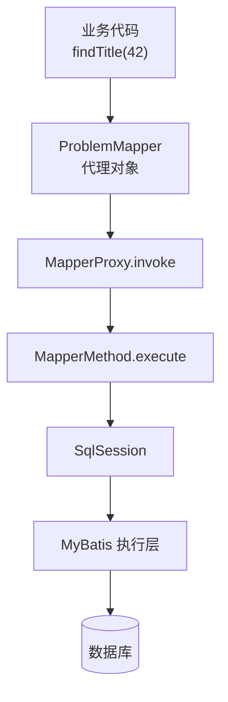

`Proxy.newProxyInstance` 接收类加载器、接口列表和 `InvocationHandler`，在运行时创建实现这些接口的代理对象。调用方按接口调用方法时，调用先进入代理类的方法实现，再由它把代理对象、被调用的 `Method` 和实参交给处理器的 `invoke`。`invoke` 的返回值成为这次接口调用的返回值；处理器可以转发给真实对象，也可以自行完成操作，因此动态代理并不要求预先存在目标实现。

## 一次调用经过哪些对象

以 Java 17 的 JDK 动态代理为例：

```text
调用方 → 接口方法 → 运行时生成的代理类方法
                           ↓
                InvocationHandler.invoke(proxy, method, args)
                           ↓
                 处理器决定执行什么、返回什么
```

生成的代理类继承 `Proxy` 并实现指定接口；它的方法负责把调用交给创建时绑定的处理器。传入的类加载器需要能够定位这些接口，接口列表决定代理对象可被当作哪些接口使用。这里的 `Method` 描述的是**调用方所调用的方法**，不是自动执行该方法的指令。处理器只有显式调用 `method.invoke(target, args)` 等转发逻辑时，目标对象的方法才会执行。没有目标对象时，处理器也可以根据方法信息执行查询、远程调用等其他操作。

## 用一个目标对象演示转发

```java
import java.lang.reflect.InvocationHandler;
import java.lang.reflect.InvocationTargetException;
import java.lang.reflect.Proxy;

public class ProxyDemo {
    interface ProblemService {
        String title(long id);
    }

    public static void main(String[] args) {
        ProblemService target = id -> "题目 " + id;

        InvocationHandler handler = (proxy, method, arguments) -> {
            long start = System.nanoTime();
            try {
                return method.invoke(target, arguments); // 转发是处理器作出的选择
            } catch (InvocationTargetException e) {
                throw e.getCause(); // 保留目标方法原本抛出的异常
            } finally {
                System.out.println("调用耗时(ns): " + (System.nanoTime() - start));
            }
        };

        ProblemService service = (ProblemService) Proxy.newProxyInstance(
                ProblemService.class.getClassLoader(),
                new Class<?>[] {ProblemService.class},
                handler);

        System.out.println(service.title(42)); // 题目 42
    }
}
```

`service` 是代理对象，`target` 是被转发的实现对象。调用 `service.title(42)` 会先进入 `handler.invoke`，再由示例中的 `method.invoke` 调用 `target.title(42)`。示例拆开 `InvocationTargetException`，因为反射调用会用它包装目标方法抛出的异常；若直接把包装异常从处理器抛出，调用方观察到的异常可能改变。实际处理器还要正确返回接口声明的类型，并处理 `equals`、`hashCode`、`toString`：它们的调用也会进入 `invoke`。处理器抛出的受检异常若未在接口方法中声明，代理会将其包装为 `UndeclaredThrowableException`。

## MyBatis 为什么需要这种代理

使用 MyBatis 时，开发者通常定义一个 Mapper 接口，例如 `ProblemMapper.findTitle(long id)`，再用 XML 或 `@Select` 为方法配置 SQL。业务代码可以通过 `SqlSession.getMapper(ProblemMapper.class)` 取得 `ProblemMapper` 并调用 `findTitle(42)`；开发者不需要编写 `ProblemMapper` 的实现类。

MyBatis 返回的 Mapper 对象是实现该接口的代理。普通 Mapper 方法被调用时，代理把方法和实参交给 `MapperProxy`，后者找到对应的映射语句，通过 `SqlSession` 执行 SQL 并处理结果。因此，这里的处理器没有一个手写的 Mapper 实现可供 `Method.invoke` 转发。它使用同一个 `InvocationHandler` 入口，把接口方法调用解释为数据库操作。前面示例中的处理器选择转发给 `target`，MyBatis 的处理器选择执行映射语句；代理机制允许这两种处理方式。



查询结果经 MyBatis 映射后沿调用链返回给业务代码。图中省略了 Mapper 方法缓存、`Executor` 和结果处理器等内部步骤，重点是看清接口调用如何进入处理器，以及处理器如何转向 SQL 执行。

JDK 动态代理生成的是**接口实现**，调用方应以这些接口使用代理。它不会因为传入了某个目标对象，就变成目标实现类的子类；需要代理没有接口的类时，应另选基于子类等机制。

## 参考

- [Java 17 Proxy API](https://docs.oracle.com/en/java/javase/17/docs/api/java.base/java/lang/reflect/Proxy.html)。
- [Java 17 InvocationHandler API](https://docs.oracle.com/en/java/javase/17/docs/api/java.base/java/lang/reflect/InvocationHandler.html)。
- [Java 17 Method.invoke API](https://docs.oracle.com/en/java/javase/17/docs/api/java.base/java/lang/reflect/Method.html#invoke(java.lang.Object,java.lang.Object...))。
- [MyBatis Java API：通过 SqlSession 获取 Mapper](https://mybatis.org/mybatis-3/java-api.html)。
- [MyBatis MapperProxy API](https://mybatis.org/mybatis-3/apidocs/org/apache/ibatis/binding/MapperProxy.html)。
