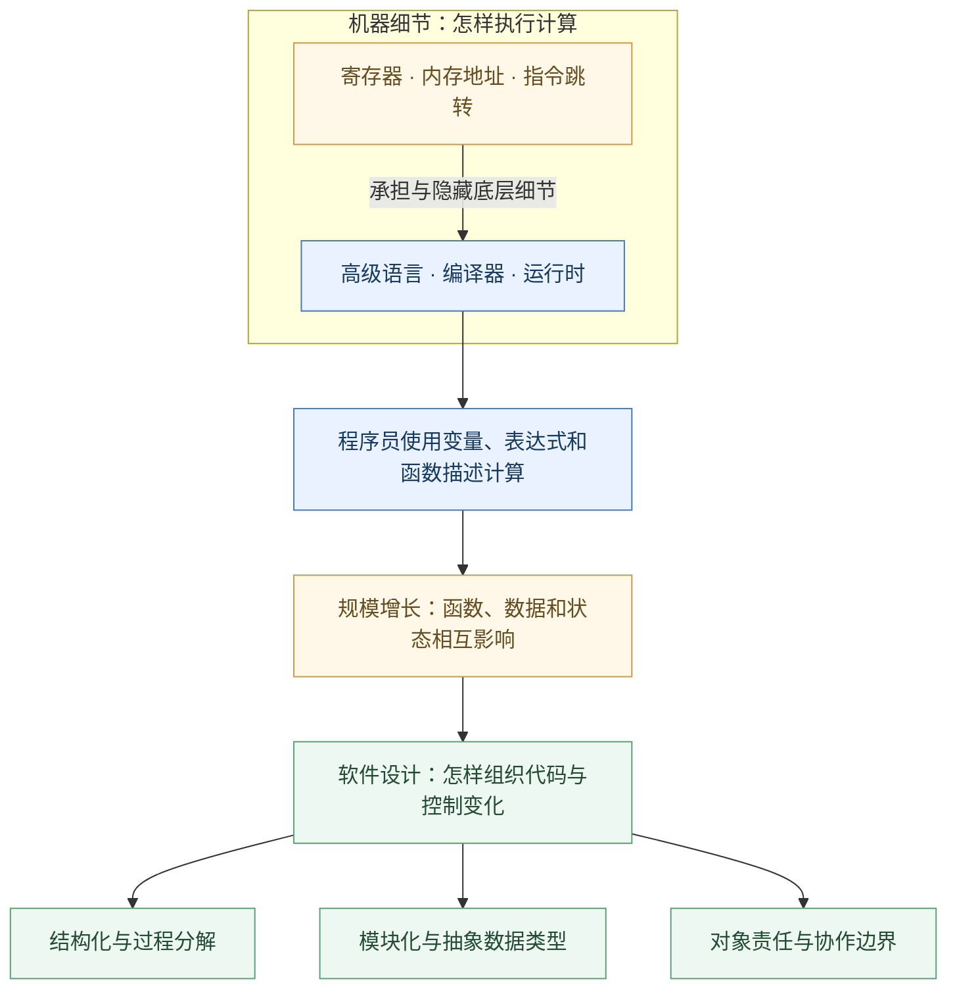
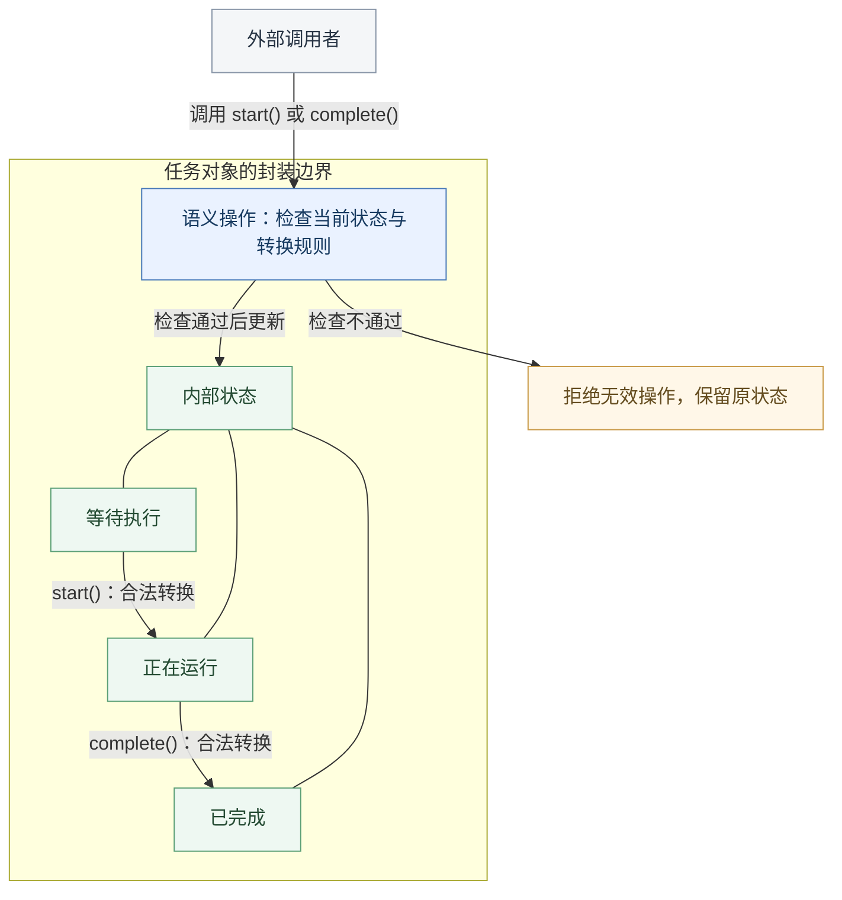
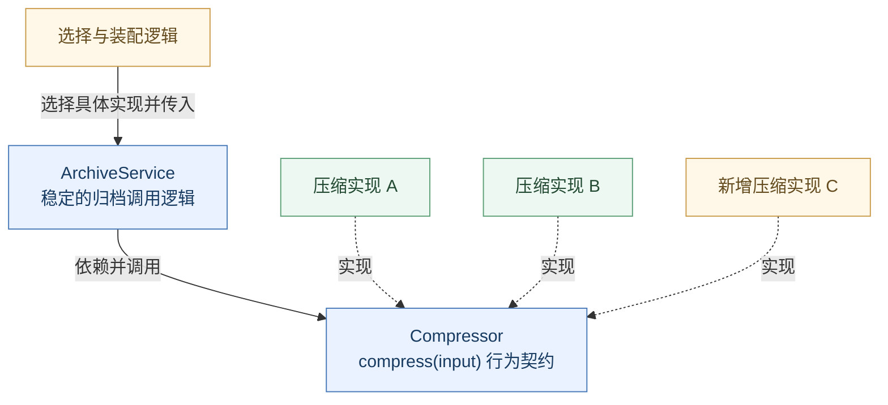
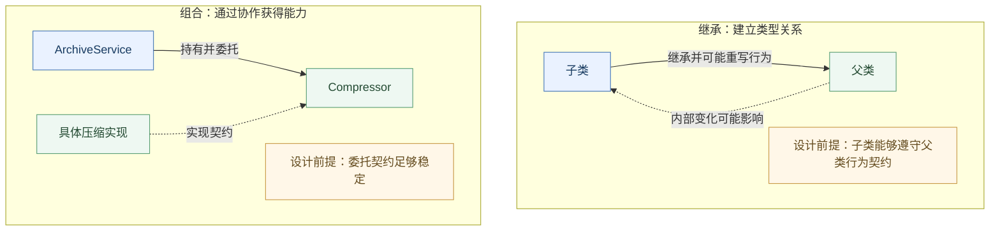

*从机器指令到软件架构，理解面向对象为何诞生、如何发挥作用，以及它真正能够解决的问题。*

## 软件工程的难题，从来不只是让程序运行起来

假设我们能够让一台计算机准确执行任何一条指令，是否就意味着我们已经掌握了软件开发？

显然不是。

编写一个能够正确运行的程序，与构建一个能够长期演进的软件系统，是两种不同层次的挑战。前者关注程序能否完成预期的计算，后者还必须考虑：当需求发生变化时，我们需要修改多少代码？当系统规模扩大时，开发者还能否理解其中的逻辑？当多个团队同时工作时，局部修改会不会引发难以预料的连锁反应？

这些问题指向软件工程中一个根本性的挑战：**如何控制复杂性，使一个不断增长的系统始终处于人类能够理解、修改和维护的范围之内。**

计算机并不害怕复杂。只要资源足够，它可以不知疲倦地执行数百万乃至数十亿条指令。真正受到限制的是人类的认知能力。我们无法同时掌握一个大型系统中的全部细节，更不可能每次修改程序时，都重新理解整个系统。

这意味着，软件设计的目标不只是让机器能够执行，还要让人能够理解。

1987 年，计算机科学家 Frederick Brooks 在著名论文《No Silver Bullet》中，将软件开发的困难区分为本质复杂性与偶然复杂性。本质复杂性来自问题本身，例如复杂的业务规则、彼此冲突的约束以及大量相互作用的状态；偶然复杂性则来自我们描述和实现这些问题所采用的技术与方式。

我们可以通过更好的语言、工具和设计方法降低偶然复杂性，却不能指望它们消除问题本身的复杂性。

因此，评价一种程序设计方法是否优秀，不应只看它能否以更少的代码实现功能，而应看它能否帮助我们**建立清晰的认知边界，限制复杂性的传播，并降低未来变化的成本。**

沿着这一思路回顾编程语言的发展，我们便能理解面向对象为什么会出现。

## 从控制机器到组织程序：复杂性问题的转移

在计算机发展的早期，程序员必须直接面对机器的工作方式。机器语言和汇编语言要求开发者关心寄存器、内存地址、指令跳转以及具体的硬件架构。

这一时期，编程的主要困难之一，是如何将人的计算意图转换成机器能够执行的操作。

高级程序设计语言的出现，改变了这一局面。

以 FORTRAN、ALGOL 及后来的 C 语言为代表，程序员开始能够使用变量、表达式、条件分支、循环和函数来描述计算，而不必亲自安排每一条机器指令。编译器负责将这些高级表达转换成底层操作。

这是一场重要的抽象革命。

**抽象的意义，在于允许我们暂时忽略某个层次的实现细节，转而使用更接近问题本身的概念思考。**

例如，程序员可以直接表达两个变量相加，而不必每次都考虑数据应放在哪个寄存器中；可以调用一个函数，而不必手动管理每次执行所涉及的全部指令跳转。

硬件的复杂性并没有消失，而是被编程语言、编译器和运行时系统承担了相当一部分。

然而，当程序从几百行发展到几万行、几十万行乃至更多时，新的困难逐渐显现。

一个大型软件往往包含大量函数、数据结构和状态。即使每个函数都很容易理解，它们组合之后的行为也可能极其复杂。某个函数修改了一份共享数据，可能影响多个模块；增加一项功能，可能需要修改分散在不同位置的判断逻辑；一个看似局部的改动，甚至可能破坏系统中原本不相关的功能。

问题由此发生了转移。

我们已经拥有了相当成熟的手段来描述计算步骤，却仍然需要回答另一个问题：

**如何组织大量相互关联的代码，使整个程序不至于随着规模增长而失去可理解性？**

结构化程序设计、模块化设计、抽象数据类型以及后来的面向对象编程，都可以被放在这一更广阔的探索过程中理解。它们并非严格依次出现，更不是简单的技术替代关系，但都尝试通过某种组织原则来约束程序的复杂性。



*图：抽象让关注点从机器细节转向程序组织；各种设计方法可以共同参与复杂性管理。*

## 面向过程与面向对象：两种不同的组织视角

要理解面向对象，首先需要避免一个常见误区：认为面向过程是一种落后的编程方式，而面向对象是它的升级版本。

这种理解过于简单。

面向过程的程序设计通常围绕操作和执行流程来组织代码。我们首先考虑需要完成哪些工作，再将复杂的工作拆解为若干相对独立的过程，通过函数调用组合这些过程。

例如，一个编译器需要经历词法分析、语法分析、语义分析、优化和代码生成等阶段。从整体上看，它天然具有某种处理流水线的结构。按照这些阶段分解程序，可以形成十分清晰的设计。

这种方法的优势在于，**它让计算过程具有清晰的顺序与结构。** 对于算法、数据转换和明确的处理流程，以函数为中心组织代码往往直接而有效。

但并非所有系统都适合仅从执行步骤的角度理解。

考虑一个持续运行的操作系统。它需要管理进程、文件、设备、内存以及各种系统资源。这些资源具有各自的状态、生命周期和操作规则，不同资源之间还存在复杂的协作关系。

如果始终从整体执行流程出发，我们可能不得不在许多操作函数中反复判断资源类型、检查状态并处理不同情况。随着系统不断扩展，相关知识会逐渐分散到越来越多的代码位置。

这里的问题并不是函数本身不好，而是**软件的组织结构没有为那些相对稳定的责任与变化边界建立足够清晰的对应关系。**

面向对象提出了另一种视角：与其首先追问整个系统需要执行哪些步骤，不如先思考系统中有哪些具有独立责任的参与者，它们各自掌握什么信息、提供什么行为，又应该如何协作。

程序不再只能被理解为一系列操作的集合，也可以被理解为一组相互协作的对象。

这种视角的变化，带来了一个重要的设计问题：

当某项功能发生变化时，我们能否将变化尽可能限制在负责该功能的对象内部，而不迫使整个系统一起修改？

这才是理解面向对象的关键。

需要强调的是，良好的过程式设计同样能够通过模块、接口和信息隐藏实现复杂性控制。面向对象并不独占这些思想，它只是提供了一套以对象及其协作为中心的表达和组织机制。

## 面向对象究竟提出了怎样的解决思路？

面向对象并不是某个人在某一天为了取代面向过程而发明的完整理论。

它的思想可以追溯到 20 世纪 60 年代。挪威计算机科学家 Ole-Johan Dahl 和 Kristen Nygaard 在开发 Simula 语言时，需要模拟一个由多个实体组成、并随时间不断变化的系统。

传统的过程和数据结构当然能够完成模拟，但如果程序能够直接表达具有独立状态与行为的模拟实体，许多复杂关系就更容易描述。Simula 67 因而发展出了类、对象、继承等后来成为面向对象基础的重要机制。

到了 20 世纪 70 年代，Alan Kay 及其同事在 Smalltalk 中进一步发展了这些思想。Smalltalk 尤其强调对象之间通过消息进行协作，而对象自身负责管理内部状态和行为。

值得注意的是，不同语言以及不同研究者对于面向对象的侧重点并不完全相同。Java 的类、接口和方法调用模型，与 Smalltalk 所强调的高度动态的消息传递模型，也存在明显差异。

但这些思想具有一条共同的线索：

**一个复杂的软件系统，可以被分解为多个具有明确责任和内部边界的对象。外部通过约定好的行为与对象交互，而不必掌握对象实现这些行为的全部细节。**

这并不意味着程序必须机械地模仿现实世界。

对象不一定要对应某个看得见、摸得着的实体。缓存、线程池、任务调度器、解析器以及网络连接管理器，都可以成为对象。它们存在的理由并不是现实中有一个同名的东西，而是它们分别承担了一组具有内在关联的责任。

因此，面向对象中的“对象”，不应简单地理解为现实世界中的物体。

它更像是一个拥有自身状态或行为、能够与其他对象协作的独立单元。在 Java 中，对象通常由类创建，具有可通过引用区分的身份，并通过方法暴露行为；有些对象拥有不断变化的状态，另一些则可以是不可变的。

一个优秀的面向对象设计，不在于找出了多少名词并将其转换成类，而在于是否合理分配了责任、建立了边界，并组织起可理解的协作关系。

那么，这样的设计是如何发挥作用的？

答案涉及几个相互联系却并不等价的机制：抽象、封装、多态，以及经常被误解的继承。

## 抽象、封装与多态：复杂性如何被限制在边界之内

### 抽象：决定哪些细节值得被看见

任何复杂系统都包含大量细节，但不是所有细节都应该同时暴露给每一个使用者。

我们使用一个文件系统时，需要知道如何读取、写入和删除文件，却通常不需要知道存储设备如何分配物理块，也不需要了解每一次缓存命中的内部过程。

这是抽象的力量：它让我们通过有限的概念理解和使用复杂的能力。

在 Java 中，类和接口都可以参与抽象。比如，`List` 描述了一组有序元素应当支持的基本操作，而 `ArrayList` 和 `LinkedList` 则采用不同的数据结构实现相应约定。

调用者在只需要列表语义时，可以依赖 `List`，而不必直接依赖某个实现的内部结构。当然，不同实现的性能与适用场景仍然可能不同，抽象不会抹去这些真实差异。

抽象并不是简单地隐藏代码，而是选择一种对使用者有意义的观察方式。

如果一个接口要求调用者理解大量实现细节，或者将底层技术的特殊约束毫无整理地暴露出来，那么即使我们使用了 Java 的 `interface` 关键字，也未必建立了良好的抽象。

**抽象的质量，取决于它能否让使用者依赖稳定的概念，而不是不断变化的实现。**

### 封装：让对象对自己的状态负责

抽象帮助我们决定应该看到什么，而封装进一步回答：哪些知识和修改权限应当留在内部？

假设一个任务具有“等待执行”“正在运行”和“已完成”三种状态。我们当然可以将任务状态定义成一个公开字段，允许其他代码直接修改。

但问题很快出现。

如果任意模块都可以随意改写状态，那么谁负责保证一个尚未开始的任务不会直接变成已完成？当状态增加更多约束时，又由谁来维护这些规则？

一种更稳健的设计，是让任务对象管理自己的状态，并对外提供 `start()`、`complete()` 等具有明确语义的操作。对象在执行操作时检查合法性，拒绝无效的状态转换。

在这种设计中，外部不需要知道状态转换的全部内部规则，也不应该任意绕过它们。



*图：以这个简化任务模型为例，外部通过语义操作请求变化，任务对象维护自己的状态约束。*

这体现了封装的真正意义：**把相互关联的数据、行为和必须维持的约束放在明确的边界之内，并由边界内部负责维护其一致性。**

在 Java 中，`private`、`protected` 等访问控制机制能够帮助我们建立这种边界，但封装绝不等于简单地将字段声明为 `private`。

如果一个类为每个字段都提供不受约束的 setter，外部仍然能够任意改变其内部状态，那么访问修饰符虽然存在，真正的封装却可能已经被破坏。

同样，一个只有字段、getter 和 setter，而所有操作规则都分散在外部的类，也不一定体现了充分的面向对象设计。

好的封装不只是隐藏数据的位置，更重要的是明确：**谁拥有这些数据，谁理解这些数据的约束，以及谁有权改变它们。**

当责任被合理集中时，修改内部表示便不一定需要修改外部使用者。复杂性因此被限制在相对局部的范围内。

### 多态：让调用者不必提前知道所有实现

封装主要控制对象内部的复杂性，而多态则为对象之间的协作提供了另一种可能。

考虑一个需要执行压缩操作的 Java 程序。

最初，它只支持一种压缩算法。随着功能扩展，程序需要支持更多算法。如果调用代码必须不断判断压缩类型，再选择不同的处理逻辑，那么每增加一种算法，就可能需要修改原有的条件分支。

面向对象允许我们改变这一组织方式。

我们可以定义一个 `Compressor` 接口，约定压缩器应提供 `compress()` 方法；不同的压缩器分别实现这个接口。调用者只依赖 `Compressor`，具体算法由运行时所使用的对象决定。

例如：

```java
interface Compressor {
    byte[] compress(byte[] input);
}

final class ArchiveService {
    private final Compressor compressor;

    ArchiveService(Compressor compressor) {
        this.compressor = compressor;
    }

    byte[] archive(byte[] data) {
        return compressor.compress(data);
    }
}
```

这段代码并不复杂，但它体现了一个重要变化。

`ArchiveService` 不再负责识别并选择所有压缩算法，而只负责调用一个满足约定的压缩器。不同实现可以被传入，在保持同一接口契约的前提下完成相同的协作任务。

这就是 Java 中基于接口的运行时多态的一种典型应用。



*图：箭头区分调用依赖与实现关系；新增算法的变化主要落在实现及装配部分，前提是接口契约保持稳定。*

多态的价值并不是让一次方法调用变得更加简短，而在于**将变化的实现与相对稳定的调用逻辑分离。**

当新增一种压缩算法时，我们通常可以增加一个新的实现，而不必修改 `ArchiveService`。变化被隔离在实现以及选择、装配实现的部分，已有调用逻辑得以保持稳定。

这种设计在依赖方向上也很有意义：原本高层代码需要知道每种具体算法，现在它可以只依赖一个相对稳定的抽象。

当然，多态并不意味着任何变化都无需修改旧代码。如果我们改变了 `Compressor` 的接口契约，所有实现仍然可能受到影响；如果系统需要增加的是一种全新的操作，而非同一操作的不同实现，原有抽象也可能不再合适。

多态解决的是特定变化维度上的可替换性，而不是对所有未来需求的预知能力。

但这已经非常重要。

一个系统之所以容易维护，往往不是因为它从不需要修改，而是因为修改的影响范围可以被合理控制。

## 继承：面向对象最有代表性，也最容易被滥用的机制

在很多 Java 教材中，封装、继承和多态被并列称为面向对象的三大特性。这种总结有助于初学者认识语言机制，却容易产生一个误解：似乎使用继承越多，程序就越符合面向对象思想。

实际上，继承解决的问题与封装、多态并不相同。

继承允许一个类在已有类的基础上定义新的类，继承可访问的行为，并在语言规则允许的范围内扩展或重写部分实现。这种机制能够减少某些重复代码，也可以建立明确的类型层次。

例如，一个特化的类如果确实满足基类的行为契约，就可能通过继承自然地表达这种关系。

但继承同时建立了紧密的依赖。

子类不仅可能依赖父类公开的方法，还可能依赖父类受保护的状态、调用顺序以及某些隐含的实现假设。当父类修改内部行为时，即使它的公开接口没有发生变化，子类也可能受到影响。

更严重的是，代码复用有时会诱使我们建立并不合理的继承关系。

假设两个类碰巧拥有相同的实现逻辑，开发者便让其中一个继承另一个。这样的设计虽然暂时减少了重复代码，却可能让两个本应独立变化的概念被迫绑定在一起。

因此，判断继承是否合理，不能只看代码是否复用，还要看子类能否在语义和行为契约上真正替代父类。这与面向对象设计中的里氏替换原则密切相关。

现代 Java 设计实践通常更强调优先考虑组合，而不是为了代码复用轻易建立类继承关系。

所谓组合，是让一个对象通过持有并使用其他对象来获得能力。例如，前面的 `ArchiveService` 并没有继承某个具体压缩器，而是通过持有一个 `Compressor` 引用，将压缩责任委托给它。

这样一来，压缩算法和归档服务可以相对独立地变化。



*图：继承与组合建立了不同的依赖关系，应根据类型语义、契约和变化边界选择。*

这并不意味着继承已经过时，更不意味着组合在任何情况下都优于继承。对于确实存在稳定类型层次和合理扩展契约的场景，继承仍然是一种有效机制。

但我们应该意识到：**继承是一种带有约束和耦合成本的设计选择，而不是面向对象编程必须追求的目标。**

甚至可以说，比起建立一个庞大而精巧的继承体系，如何识别稳定的抽象、划分合理的责任以及控制对象之间的依赖，往往更加重要。

## 面向对象没有消除复杂性，只是改变了管理复杂性的方式

理解了这些机制之后，我们仍然需要面对一个问题：为什么有些 Java 项目使用了大量类、接口、继承与设计模式，却依然难以理解和维护？

因为面向对象并不是一种能够自动产生良好设计的语法。

它提供了一组组织复杂性的工具，但并不替我们判断应该如何使用这些工具。

抽象可以降低对具体实现的依赖，也可能因为层次过多而增加理解成本；封装可以隐藏细节，也可能因为边界划分不合理而产生大量不必要的间接调用；多态可以隔离变化，也可能在并不存在真实变化需求时引入冗余接口；继承能够复用实现，也可能将系统变成脆弱而难以调整的类型层次。

换句话说，我们可能为了减少一种复杂性，又引入了另一种复杂性。

而且，并不是所有问题都需要围绕长期存在、拥有自身状态的对象组织。

对于数值计算、数据转换、批量处理等问题，以函数和数据流为中心的设计可能更加自然。函数式编程强调不可变数据、函数组合与副作用控制，能够从另一条路径降低共享可变状态所带来的复杂性。

特别是在并发环境中，如果多个对象之间存在大量共享的可变状态，即使每个对象都封装了自己的字段，系统整体依然可能出现竞态条件、死锁和难以复现的状态错误。单个对象的封装，并不自动保证整个系统的线程安全。

同样，在分布式系统中，对象之间看似简单的方法调用，无法替我们解决网络失败、数据一致性、故障恢复与事务边界等问题。

面向对象的许多优势依赖合理的抽象边界，而这些边界本身就是设计者必须完成的工作。

Java 也并不是一种只能采用面向对象方式编程的语言。它保留了基本类型、静态方法和过程式控制结构，并在发展过程中引入 Lambda 表达式、Stream API、Record 等特性，让开发者能够使用多种方式表达不同的问题。

成熟的软件设计不应将某种范式视为信仰，而应理解不同范式所针对的复杂性来源。

当主要困难在于组织大量长期协作、具有明确职责的组件时，面向对象通常能够提供有价值的设计视角；当主要困难在于描述一系列数据变换时，函数组合或过程式分解可能更加简洁；当主要困难在于状态和并发时，不可变性、消息通信与显式的并发控制机制可能更加关键。

我们真正需要掌握的不是某种范式的全部语法，而是判断什么时候应该采用哪一种组织方式。

## 回到 Java：学习面向对象，究竟是在学习什么？

现在，我们可以重新审视 Java 中那些熟悉的概念。

类不只是定义字段和方法的语法结构，它还可以成为组织相关责任与实现细节的边界。

对象不只是通过 `new` 创建出来的一块内存实例，它还代表程序运行时一个能够维护自身约束并参与协作的实体。

接口不只是等待实现的抽象方法集合，它可以表达组件之间相对稳定的行为契约。

封装不只是 `private` 关键字，多态不只是父类引用指向子类对象，继承也不只是通过 `extends` 减少重复代码。

这些语言机制背后，都隐藏着关于软件复杂性的设计选择。

学习 Java，当然需要理解对象如何创建、引用如何传递、方法如何分派，以及 JVM 如何管理对象的生命周期。这些技术细节构成我们正确使用语言的基础。

但如果希望从“能够编写 Java 程序”进一步走向“能够设计易于维护的 Java 软件”，就需要不断追问另一层问题：

为什么这段逻辑属于这个对象，而不是另一个对象？为什么这里应该依赖接口，而不是具体实现？为什么某项状态应该被隐藏？为什么一个继承关系看起来合理，却会让未来的修改变得困难？

这些问题没有脱离 Java，恰恰相反，它们解释了许多 Java 语言机制的设计价值。

我们最终会发现，良好的面向对象设计，往往不是让程序拥有更多对象、更多抽象类和更多设计模式，而是让系统中的每一个重要概念都有恰当的表达，让每一项责任都有清晰的归属，让变化不必轻易穿透整个系统。

## 结语：软件设计，是对复杂性与变化的持续管理

回顾程序设计的发展，一条清晰的主线逐渐浮现。

编程语言的抽象，让我们能够摆脱大量机器细节，更直接地描述计算。结构化与模块化设计，让复杂程序能够被拆分和组织。面向对象进一步提供了一种以责任、封装边界与对象协作为中心的设计视角，使开发者能够在适当的场景中隔离实现细节，并为未来的变化预留空间。

但软件的复杂性并不会因为使用了类、接口和多态而凭空消失。

它只是有机会被重新组织：原本散落在系统各处的规则，可以集中到明确的责任边界中；原本依赖具体实现的代码，可以转而依赖稳定的行为契约；原本容易相互牵连的变化，可以在一定程度上被分离。

当然，这一切都有代价，也都需要判断。

因此，**面向对象最值得学习的，不是如何把所有东西写成对象，而是如何通过合理的抽象、明确的责任和受控的依赖，使复杂的软件保持可理解、可修改和可扩展。**

从这个意义上说，面向对象并不是关于“对象”的终极答案，而是软件工程面对复杂性时形成的一种重要设计思想。

理解这一点，才是深入学习 Java 面向对象机制的真正起点。
