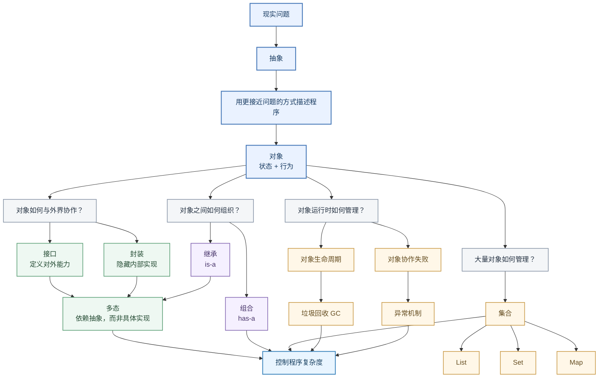

程序最终是用来解决现实问题的，但现实问题和计算机之间隔着一道巨大的鸿沟。

现实世界里，我们会讨论用户、订单、账单、支付；而计算机真正执行的，却是指令、内存读写、寄存器操作和条件跳转。如果程序员每解决一个业务问题，都必须同时考虑这些底层细节，那么软件几乎不可能发展到今天的复杂程度。

因此，程序设计首先是一件关于“抽象”的事情。所谓抽象，就是在当前问题中，只关注重要的部分，暂时忽略不重要的细节。

当我们使用高级语言编程时，其实已经站在了许多层抽象之上。但仅仅隐藏计算机的底层细节还不够，更重要的问题是：**我们应该用什么方式描述现实世界中的问题？**

面向对象编程（OOP）给出了一种答案。



## 第一层抽象：用“对象”映射现实

在面向对象的世界里，我们尝试把问题中的概念建模成一个个对象。一个对象通常同时包含状态和行为。

以一个电商交易系统为例，我们思考程序时，不再首先考虑内存、循环和条件判断，而是开始思考：“一个账户应该提供什么能力？”“一个订单应该如何支付？”

```java
class Account {
    private BigDecimal balance; // 状态：余额

    // 行为：对外提供的能力
    public void deposit(BigDecimal amount) {
        // ...
    }

    public void withdraw(BigDecimal amount) {
        // ...
    }
}
```

程序中的概念开始逐渐接近我们正在解决的问题本身。一旦对象建立，**接口**与**封装**就自然出现了。

对于调用者来说，他只需要知道“我可以调用 `deposit` 和 `withdraw` 方法”，而不需要知道余额具体存在哪里、数据库如何更新。这里的“接口”不仅指 `interface` 关键字，更指代**一个对象允许外部依赖哪些能力**。

如果调用者只需要知道 `Account` 可以存款和取款，那么账户内部究竟怎样保存余额，就不应该成为调用者必须了解的事情，这就是封装。

> **核心洞察：**
>
> 接口决定了“我希望别人依赖什么”。
> 封装决定了“我不希望别人依赖什么”。
>
> 这两者共同降低了程序模块之间的耦合，让抽象真正转化为代码的可维护性。

## 第二层抽象：建立对象间的协作关系

对象并不是孤立存在的，一个真实程序往往由大量对象协作完成。我们需要描述对象之间的关系。

**组合（Composition）表达了“拥有的关系（has-a）”。**
一个复杂对象可以由多个更小的对象组合而成，例如一个订单包含了多个商品明细和所属用户：

```java
class Order {
    private User buyer;
    private List<OrderItem> items;
}
```

**多态（Polymorphism）则赋予了系统极强的扩展能力。**
在建立对象类型关系时（如继承或实现接口），比“代码复用”更重要的是，它确立了一种契约。假设我们需要处理订单的支付：

```java
interface Payment {
    void pay();
}

class AliPay implements Payment {
    public void pay() { /* 支付宝支付逻辑 */ }
}

class WeChatPay implements Payment {
    public void pay() { /* 微信支付逻辑 */ }
}
```

此时，业务代码只需要依赖 `Payment` 这个抽象能力：

```java
void checkout(Payment payment) {
    payment.pay();
}
```

`checkout` 方法不需要提前知道传进来的是 `AliPay` 还是 `WeChatPay`。具体调用哪段实现代码，等到程序运行时再决定。

> **核心洞察：**
>
> 从运行机制看，多态是运行期的动态绑定；但从程序设计角度看，它的核心意义在于：**调用者依赖的是一种能力，而不是某个具体实现。**
> 当新的支付方式出现时，只需增加新的实现类，不必修改任何已有业务代码。

## 第三层抽象：应对规模膨胀与协作意外

当面向对象的基本模型形成后，真实的电商系统里可能存在几万个用户、几十万个订单。于是，一系列实际的工程问题接踵而至，而 Java 提供的诸多机制，正是为了解决这些必然出现的复杂性。

**1. 对象太多了怎么办？—— 集合（Collections）**
当对象从一个变成一群，我们需要管理它们。Java 提供了 `List`（处理有序集合）、`Set`（处理防重集合）、`Map`（处理键值映射）。集合并不是孤立的 API，而是建立在对象模型之上，专门解决海量对象组织问题的工具。

**2. 对象不用了怎么办？—— 垃圾回收（GC）**
程序不断运行，每天有无数临时订单对象被创建。如果不管它们，内存很快就会耗尽。Java 的答案是：程序员负责 `new` 对象，而 JVM 的垃圾回收器负责寻找并清理那些不再被使用的对象。垃圾回收本质上是 Java 对**对象生命周期管理**给出的系统级方案。

**3. 对象协作失败了怎么办？—— 异常（Exceptions）**
网络可能中断，支付可能余额不足。如果一个对象在执行服务时失败了，这种失败应该怎样传递给调用者？异常机制提供了一条区别于“正常返回”的路径，专门用于传播和处理对象协作过程中的意外。

## 总结：筑起抵御复杂度的长城

如果我们回过头来看，会发现 Java 中很多原本看起来零散的概念，其实有着极其严密的内在逻辑：

* **现实问题** → 提取**对象**
* **隐藏实现细节** → 依托**接口**与**封装**
* **建立对象协作** → 运用**组合**与**多态**
* **管理对象规模** → 引入**集合**
* **管理对象消亡** → 依赖**垃圾回收 (GC)**
* **处理协作失败** → 使用**异常机制**

它们最终都在齐心协力解决同一个终极问题：**如何控制程序不断增长的复杂度。**

学习一门语言时，如果只是把语法、集合、GC 分别当成独立知识点去死记硬背，很容易迷失。更好的方式是不断追问：这个机制究竟隐藏了什么细节？它建立了什么抽象？

程序最终仍然会运行在 CPU 上，变成冷冰冰的机器指令。但程序员每天面对的，应该是问题本身。编程语言最重要的价值，就是不断替我们筑起新的抽象层，让我们得以暂时忘记底层的复杂细节，站在更高的地方审视现实世界。
